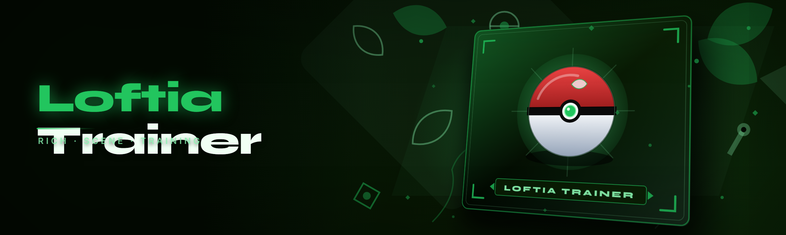

  
  
  

  

  
  
  
  

---

Loftia Trainer: aimbot, ESP, wallhack, speed hack, and injector loader for Loftia — memory patcher with bypass and config hotkeys.

## Overview

Loftia Trainer: aimbot, ESP, wallhack, speed hack, and injector loader for Loftia — memory patcher with bypass and config hotkeys.

  

## License

[MIT License](LICENSE)

  

